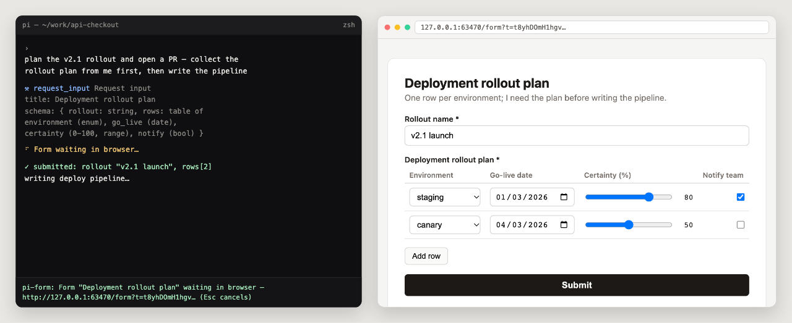
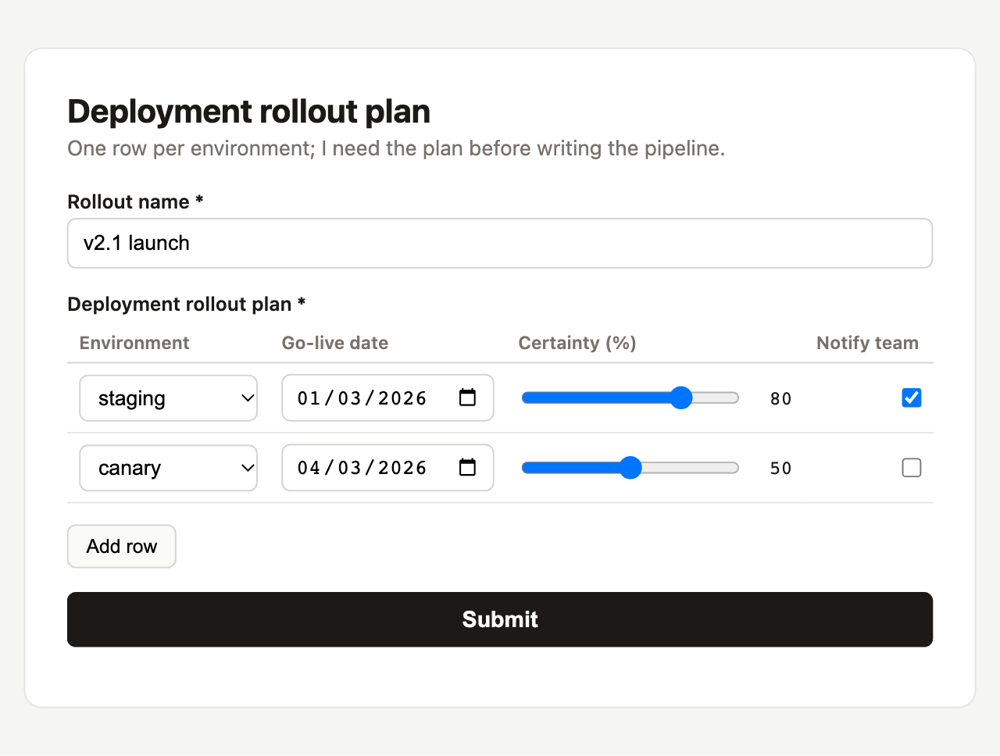

# pi-form

A [pi](https://pi.dev) extension. When the agent needs structured input from
you mid-run, it authors a JSON Schema for the input, pi-form renders a form
from that schema in your **default browser**, you fill it in, the submission
is validated by [pi's own schema engine](https://github.com/earendil-works/pi/tree/main/packages/schema),
and the validated object is returned to the agent so the run continues with
real data.



```
agent: "I need a book title and a 1-5 rating"
   │
   ├─ calls request_input(title, schema)          (tool call)
   ├─ pi-form opens http://127.0.0.1:<port>/form  (default browser)
   ├─ you fill the form, submit
   └─ {"book_title":"Dune","rating":5}            (tool result → agent)
```

Terminal stays usable the whole time; the footer shows the form URL and
`Esc` cancels the form and closes the server.

## Install

**From npm (recommended):**

```sh
pi install npm:pi-form
```

**From git:**

```sh
pi install git:github.com/giacomorebonato/pi-form
```

**Option A — settings.json:** add the repo path to
`~/.pi/agent/settings.json`:

```json
{
  "extensions": [
    "/absolute/path/to/pi-form"
  ]
}
```

**Option B — extensions dir:** symlink it into pi's global extensions:

```sh
ln -s /absolute/path/to/pi-form ~/.pi/agent/extensions/pi-form
```

**One-off:** `pi -e /absolute/path/to/pi-form/index.ts`

Requires Node >= 20, pi >= 1.5.

## Usage

Just ask, e.g.:

> Before you continue, use request_input to ask me for the deployment target
> (enum: staging, production), a version string, and whether to notify the
> team (boolean).

The agent calls the `request_input` tool with a JSON Schema; your browser
opens the form. Fields render from the schema (labels from `description`,
defaults pre-filled, required fields marked). Invalid submissions show
per-field, per-cell errors from server-side validation and never reach the
agent.

## Showcase

Arrays of flat objects render as an **editable table of inputs** — one row
per item, one column per property, every cell a native control (select, date
picker, range slider, checkbox). The agent asked for a deployment rollout
plan and prefilled two rows via `default`:



```json
{
  "type": "object",
  "required": ["rollout", "rows"],
  "properties": {
    "rollout": { "type": "string", "description": "Rollout name", "minLength": 2, "default": "v2.1 launch" },
    "rows": {
      "type": "array",
      "description": "Deployment rollout plan",
      "items": {
        "type": "object",
        "required": ["environment", "go_live"],
        "properties": {
          "environment": { "type": "string", "description": "Environment", "enum": ["staging", "canary", "production"] },
          "go_live": { "type": "string", "description": "Go-live date", "format": "date" },
          "certainty": { "type": "integer", "description": "Certainty (%)", "minimum": 0, "maximum": 100, "x-widget": "range" },
          "notify": { "type": "boolean", "description": "Notify team" }
        }
      },
      "default": [
        { "environment": "staging", "go_live": "2026-03-01", "certainty": 80, "notify": true },
        { "environment": "canary", "go_live": "2026-03-04", "certainty": 50 }
      ]
    }
  }
}
```

## Supported schema subset

| Feature | Form rendering |
|---|---|
| `string` (+ `minLength`, `maxLength`, `pattern`) | text input (re-validated server-side) |
| string `format: "date"` | native date picker, validated as `YYYY-MM-DD` |
| `number`, `integer` (+ `minimum`, `maximum`) | number input |
| `x-widget: "range"` (bounded `integer`) | range slider with live value readout |
| `boolean` | checkbox |
| string `enum` | select |
| array of `string`/`number` | repeatable inputs |
| array of `enum` | checkbox group |
| array of flat objects | editable table (native control per cell) |
| one nested `object` level | fieldset |
| `description`, `default`, `required` | label/help text, prefill, `*` mark |

Anything outside the subset — `oneOf`/`anyOf`/`allOf`, `$ref`, conditionals,
objects or arrays nested inside table items, deeper nesting — is rejected
with a path-qualified error the agent reads and fixes. `title` and unknown
metadata keys are ignored.

## Security

- The form server binds `127.0.0.1` only, on an ephemeral port, and guards
  every request with a random 32-byte token in the URL.
- The server closes after a valid submission, abort (`Esc`), or timeout
  (default 600s; the agent can pass `timeoutSeconds`).
- Everything the agent authored (title, description, schema) is untrusted:
  HTML-escaped in the page, `<`-neutralized inside the JSON payload.
- Submissions over 1 MiB are rejected. Only one form can be pending at a time.

## Development

```sh
bun install
bun run test    # vitest, unit + live-server tests
```

Manual check: `pi -e "$(pwd)/index.ts"` and ask the agent to use
`request_input`.

Layout: `index.ts` (extension entry, `request_input` tool) · `src/subset.ts`
(supported-schema checker) · `src/form-html.ts` (self-contained form page)
· `src/server.ts` (localhost form server; validates with
`@earendil-works/pi-schema`) · `src/server-types.ts` (shared types) ·
`src/open-browser.ts` (default-browser opener).

Regenerating `assets/`: start a one-off form via `startForm` with the
showcase schema above, screenshot the page at ~900px width for
`form-table.png`; the hero composites that shot with a terminal mock. No
script ships — it's a manual capture.
